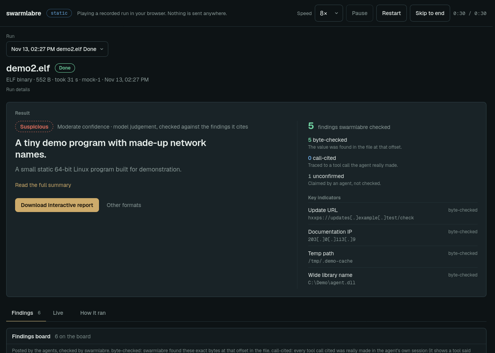
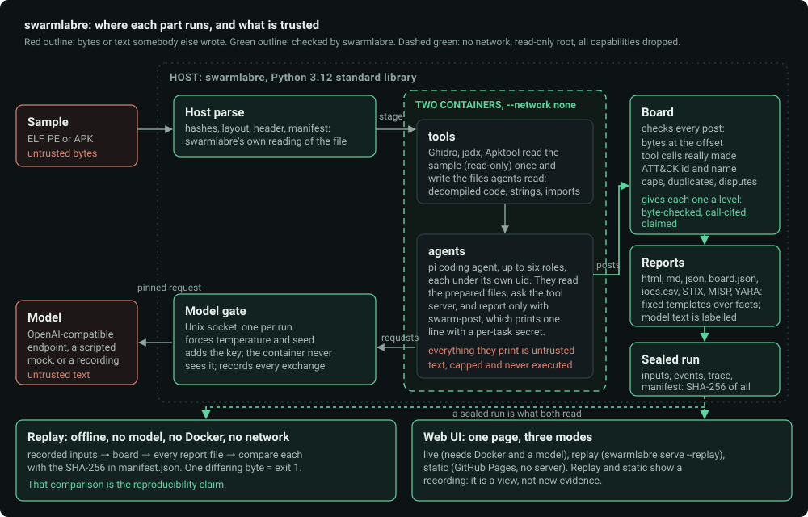
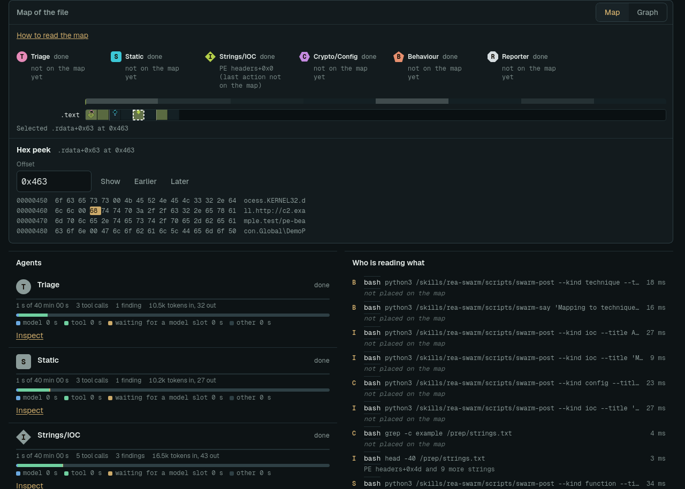
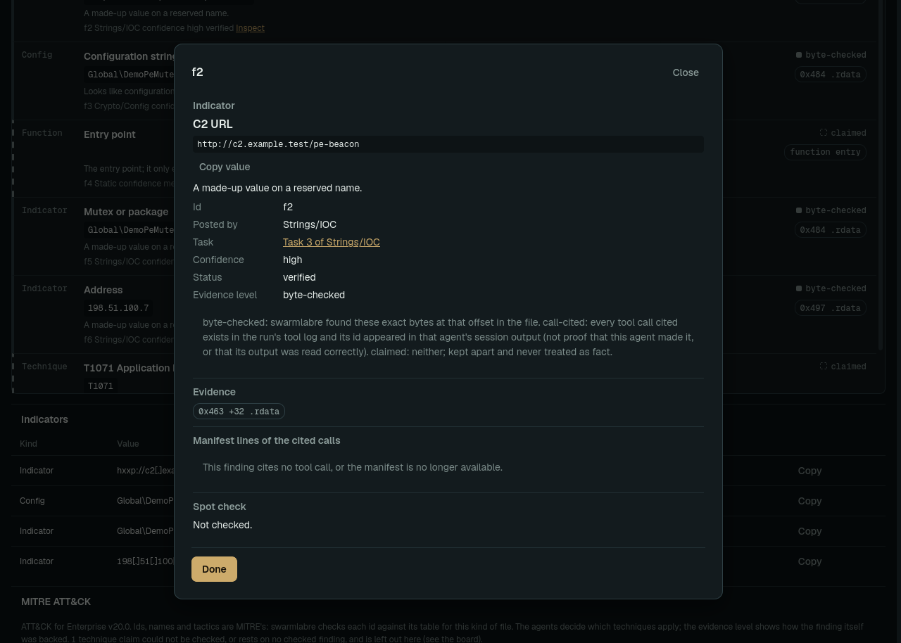
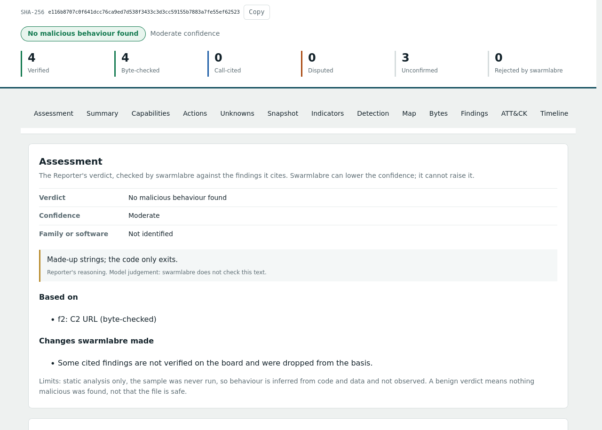
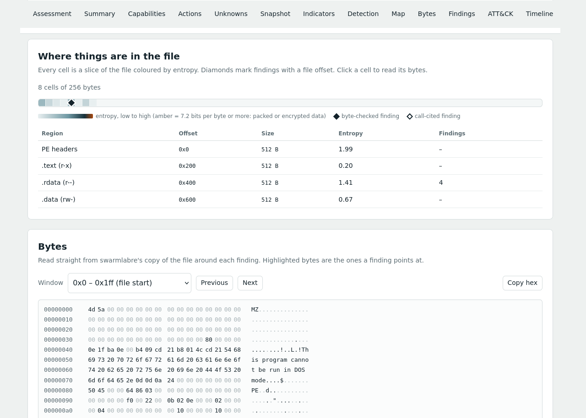

# swarmlabre

Up to six AI agents analyse one binary (ELF, PE or APK) at the same time. They share one findings board, and swarmlabre checks every finding against the
file's own bytes and against the tool calls the run really made. The report is built from the checked facts; the agents' prose is labelled as model text.
A finished run is sealed and **replays offline to byte-identical report files**.



**Try it without installing anything:** the [live demo](https://swrm.re/demo/) is the real web UI playing a recorded run in your browser. It runs
no model and sends nothing anywhere. The sample is a harmless generated program that only exits; the agents were a scripted mock, so what you see is the pipeline and the
checks, not the quality of any model. The same demo, a sample report and a short summary are on the one-page site, [swrm.re](https://swrm.re/).

**Status: alpha, 0.1.0.** It was built and checked on one machine (Linux arm64, Python 3.12.3). The checks that exist, and the ones that do not, are listed in
[docs/determinism.md](docs/determinism.md) and [SECURITY.md](SECURITY.md); please read the second before you point it at a real malware sample.

## How it fits together



The agents run in containers with `--network none` and never hold the model's key; the model reaches them only through a socket swarmlabre owns.
Everything they or the sample print is untrusted text. See [docs/architecture.md](docs/architecture.md) for the parts, the trust boundaries and the files of a run.

## Look first: Python 3.12 only, no Docker, no GPU, no key, no network

The repository carries a recorded run (`demo/sfaef16e6`: a harmless generated program, analysed with a scripted model) and 11 golden cases (`tests/golden/`). All of this works
after a plain `git clone`:

```sh
python3 -m swarmlabre replay demo/sfaef16e6                         # rebuilds every report file offline; exit 0 only if every byte is the recorded one
python3 -m swarmlabre serve --replay demo/sfaef16e6 --speed 8       # the web UI playing that recording (prints an address with a #token= part)
python3 -m unittest discover -s tests                               # the whole suite, golden cases included
python3 tests/goldenrun.py --check --twice                          # replay every golden case twice and compare with the committed outputs
```

Docker is needed only to **analyse a new file** (the agents and Ghidra/jadx run in containers); replaying, the UI, the static demo, the tests and CI never use it.

## Analyse a file yourself (needs Docker and the images)

You need Python 3.12, Docker, and about 10 minutes for the one-time image build (the tools image compiles Ghidra's decompiler for arm64, so today this runs on
arm64 Linux only). With the scripted mock model it needs no GPU, no key and no network.

```sh
docker build -t swarmlabre-agent sandbox/
docker build -f sandbox/Dockerfile.re -t swarmlabre-tools sandbox/
python3 -m swarmlabre demo out-demo/             # writes a harmless demo.elf and the script of a mock model
python3 -m swarmlabre run out-demo/demo.elf --mock out-demo/mock-script.json --out out/
```

The run takes about a minute and writes `report.html`, `report.md`, `report.json`, `board.json`, the IOC files (`iocs.csv`, STIX, MISP) and, when the file has enough
strings, `detection.yar`.

## Use a real model

Any OpenAI-compatible endpoint (llama.cpp, vLLM, Ollama, a hosted API):

```toml
# swarmlabre.toml (see swarmlabre.example.toml for every key)
[model]
base_url    = "http://127.0.0.1:8080/v1"
api_key_env = "SWARMLABRE_API_KEY"     # the key is read from this environment variable and never enters a container
temperature = 0.0                      # pinned on every request, whatever the agent's client asked for
seed        = 1
```

`python3 -m swarmlabre run sample.elf` then runs the six roles against it. Before a run it asks the endpoint the same short question twice with one seed and records in
the run whether the server honoured the seed (`seed_support` in `swarm.json`).

## The web UI

```sh
python3 -m swarmlabre serve                                  # live: needs Docker, the two images and a model ([model] in swarmlabre.toml)
python3 -m swarmlabre serve --replay demo/sfaef16e6 --speed 8   # a recorded run, eight times faster than it happened
python3 tools/build-demo.py demo/sfaef16e6 --out site/demo      # a folder you can host anywhere; it loads with the network blocked
```

One page (`ui/swarms.html`, vanilla JavaScript, no external request, its two fonts self-hosted): the launch sheet, the Live tab (map of the file, call graph, hex peek, agents,
who is reading what), the Findings tab and the result card, and "How it ran". The server listens on this machine only and asks for a token it prints once. Replay and the static
demo show a *recording*: see [docs/ui.md](docs/ui.md) for what a recording does and does not hold.

### More of the page and the report

These come from the recorded run of a generated 2 KB Windows program (the `pe-basic` golden case), so the file is tiny and the map has few cells; a real sample fills it.

**The map of the file and the hex peek.** Cells are slices of the file, coloured by entropy; a marker sits where a finding points. Click a cell, a region or type an offset to read
the bytes there, with the finding's bytes highlighted.



**One finding opened.** The evidence level, who posted it and from which task, the offset and region of the bytes, and the cited calls. A claimed finding opens the same drawer with
the level *claimed*.



**The report is one file** (`report.html`: it makes no request to any other site). It starts with the verdict and the counts of what was checked:



and shows the structure of the file next to the bytes the findings point at:



The ATT&CK strip and the call graph are not shown here: no recorded run in this repository has a *verified* technique, and the generated samples have one function each, so both
would be empty. They fill in when a run has a verified technique, or functions with call edges.

## Reproducibility in one paragraph

Every run is sealed with a `manifest.json` (tool version, sample hash, model and sampling, image ids, and the SHA-256 of every input and output file), the board's inputs
in order, and every model exchange. `swarmlabre replay` rebuilds the board and all report files offline from that record and fails if one byte differs. A *live* run is
pinned (temperature and seed are forced on every request) and recorded, but not promised to repeat: six agents share one model. See [docs/determinism.md](docs/determinism.md).

## Commands

| Command | What it does |
|---|---|
| `run SAMPLE [--mock SCRIPT] [--brief TEXT] [--roles a,b] [--tlp X] [--out DIR]` | analyse a sample |
| `report RUN [--out DIR]` | rebuild every report format from a stored run folder |
| `replay RUN [--out DIR] [--no-sample]` | rebuild a recorded run offline and compare every file with its manifest (exit 0 = all identical) |
| `export RUN DEST [--with-sample]` | pack a sealed run into a small folder that `replay` can rebuild anywhere |
| `run SAMPLE --replay RUN` | run the containers against the recorded model replies of an earlier run |
| `demo DIR` | write the harmless demo sample and its mock script |
| `corpus DIR [NAME ...]` | write the benign generated samples: `elf-benign`, `elf-wide`, `pe-benign`, `apk-benign`, `elf-hostile` (strings that try to steer a model, a page or a spreadsheet) and `script-sh` (not analysable: swarmlabre takes ELF, PE and APK only) |
| `serve [--host H] [--port N]` | the web UI on this machine (default `127.0.0.1:8810`): launch a run, watch it live, read the report. Prints one address with a `#token=` part; open that |
| `serve --replay RUN [--speed N\|real] [--paused]` | the same UI playing a recorded run (a sealed folder or an exported bundle) with no model and no Docker |
| `python3 tools/build-demo.py BUNDLE [--out site/demo]` | writes the static demo: one self-contained page that plays a recorded run in the browser with no server |

Exit codes: 0 done, 1 the work failed, 2 bad usage or input, 3 needs a model and none is configured, 130 stopped with Ctrl-C.

## How it is kept safe

Both containers run with `--network none`, a read-only root, all capabilities dropped, memory and pid limits. The model reaches the agent container only through a
Unix socket the run owns; the key stays outside. Whatever an agent, the sample or a tool prints is untrusted text: it is cleaned, capped and never executed.

## Tests

```sh
python3 -m unittest discover -s tests                       # 164 tests, no Docker, no model (the browser checks skip without Firefox; SWARMLABRE_SKIP_BROWSER=1 skips them)
python3 tests/goldenrun.py --check --twice                  # the 11 golden cases (tests/golden): replay each twice, compare every output byte for byte
python3 tests/goldenrun.py --update-golden                  # PROPOSES new golden files: shows the diff and a review token, writes nothing (see docs/determinism.md)
python3 tests/ui/parity.py                                  # text parity of the page at 1280 and 500 px in live, replay and static (headless Firefox + geckodriver)
python3 tests/ui/tour.py                                    # walks every tab, drawer and download of the page, offline
SWARMLABRE_E2E=1 python3 -m unittest discover -s tests      # adds a whole run in real containers with the mock model (needs the two images; about a minute and a half)
```

## What this is not

- Not a sandbox for **running** malware: the sample is only read, never executed. Do not point it at a file you could not safely open in a disassembler.
- Not a claim that a verdict is right. A verdict, a family name and a confidence are a model's opinion, capped by what the board could check. A finding marked *byte-checked*
  means the bytes are there at that offset; it does not mean the agent's reading of them is correct.
- Not repeatable for a *live* model run. Replay of a recording is byte-identical; a second live run on the same file can differ ([docs/determinism.md](docs/determinism.md)).
- Not tested on other CPU architectures or with more than one model, and no check in this repository involves real malware: the tests and the demo use generated benign files only. The tools image builds for arm64 only today.

## More

| | |
|---|---|
| [docs/architecture.md](docs/architecture.md) | the parts, the data flow, the trust boundaries, the files of a run |
| [docs/determinism.md](docs/determinism.md) | what "reproducible" covers, the golden cases, what they do not cover |
| [docs/ui.md](docs/ui.md) | the web UI: three modes, the server, what a recording does not hold |
| [SECURITY.md](SECURITY.md) | the threat model, what is not claimed, how to report a problem |
| [THIRD_PARTY.md](THIRD_PARTY.md) | every third-party component with its licence |

Licence: MIT ([LICENSE](LICENSE)); third-party components keep their own, see [THIRD_PARTY.md](THIRD_PARTY.md).
