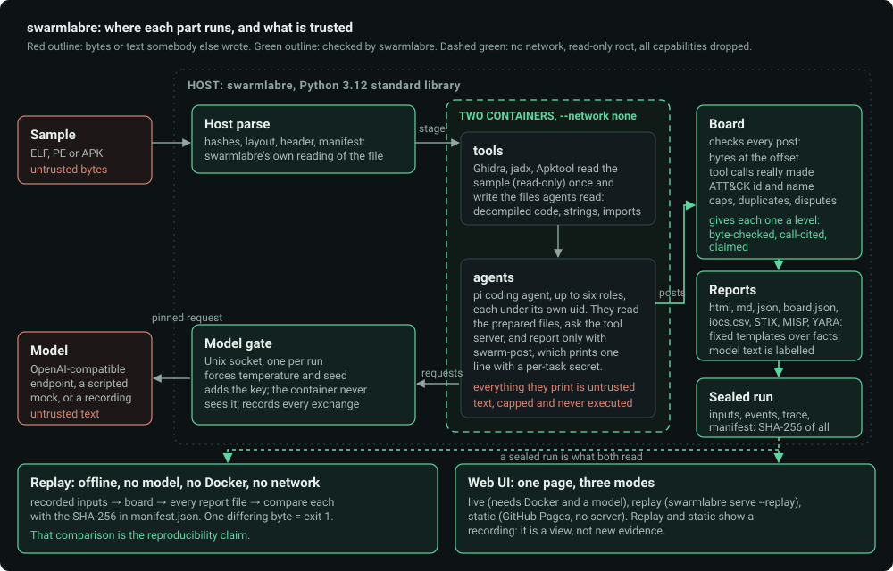

# Architecture

swarmlabre is a Python 3.12 program that uses only the standard library: no package to install, no build step. Docker is needed only to analyse a new file. Everything else
(replay, the web UI, the static demo, the tests, CI) runs without it.

## The parts

| Part | Where | What it does |
|---|---|---|
| **Host parse** (`report.py`, `swarms.py`) | host | Reads the sample itself: hashes, header, segments, entropy, the APK manifest. The layout, the regions and the numbers in a report come from here, never from an agent. |
| **tools container** (`swarmlabre-tools`) | Docker, `--network none` | Ghidra (headless), jadx, Apktool and the `rea` command line read the sample (mounted read-only) once and write the files the agents read: strings, imports, functions, decompiled code. The host adds an ATT&CK lookup table written from MITRE's data. Runs `prep_script.py`, which is piped in on stdin and never mounted. |
| **agents container** (`swarmlabre-agent`) | Docker, `--network none` | The [pi](https://github.com/earendil-works/pi) coding agent, up to six roles (Triage, Static, Strings/IOC, Crypto/Config, Behaviour, Reporter), each under its own uid. They read the prepared files, call the tool server through a locked socket, and report with `skills/rea-swarm/scripts/swarm-post`. |
| **Model gate** (`gate.py`) | host | A Unix-socket HTTP server between the agents and the model. It overwrites `temperature` and `seed` in every request, adds the key (the container never sees it), limits requests in flight, and records every exchange. |
| **Model client** (`client.py`) | host | Where the answers come from: an OpenAI-compatible endpoint (`OpenAICompat`), a scripted `Mock` (no GPU, no key, no network), or a recorded run. |
| **Board** (`swarms.py`, class `Board`) | host | Takes every post and decides: the bytes at the offset must be the value given (`byte-checked`); or every cited tool call must exist in the run's tool log and appear in that agent's own session output (`call-cited`; it is attributed by text, see [SECURITY.md](../SECURITY.md)); otherwise the finding is `claimed`. It also checks the ATT&CK id and name against MITRE's table, the function against the function list, duplicates, per-role and per-run caps, and disputes between agents. A refused post is kept with a reason code. |
| **Report writers** (`report.py`, `htmlreport.py`, `text.py`, `export.py`, `yara.py`) | host | Build `report.html`, `report.md`, `report.json`, `board.json`, `iocs.csv`, `iocs.stix.json`, `iocs.misp.json` and `detection.yar` from checked facts. Sentences about what a finding means are fixed templates; the Reporter's prose is cut sentence by sentence by a lint and always labelled. A YARA rule is written only from byte-checked strings and matched against the sample by the repo's own matcher before it is shown. |
| **Replay** (`replay.py`, `player.py`) | host | `swarmlabre replay` rebuilds every output from the recorded inputs and compares each file with its SHA-256. `player.Replay` plays a recording through the web UI. |
| **Server and UI** (`server.py`, `ui/swarms.html`) | host | A stdlib `http.server`: one page, bearer token, loopback only by default. Three modes: live, replay, static ([ui.md](ui.md)). |

## One live run, in order

1. **Stage and parse.** The sample is copied into the run folder (`<state>/runs/<id>/input/`), hashed and parsed on the host. A sample is an ELF, a PE or an APK, up to the size limits in the config.
2. **Prepare.** The tools container opens the sample and writes the `prep/` files. Nothing an agent has done yet.
3. **Round 1.** Triage, Static, Strings/IOC and Crypto/Config start together; Behaviour starts when findings exist; the Reporter runs last. Each agent works in its own task with a time limit.
4. **Post.** An agent prints a line `@@SWARM <nonce> <json>` through `swarm-post`. The nonce is an HMAC of a per-run key over (role, n-th task); a line that does not carry the task's own nonce is ignored, so a forged line inside a sample's strings is not read. The host reads the line from the agent's own tool-result stream and hands it to the board.
5. **Round 2 (optional).** The orchestrator model may plan one more round, mainly to settle disputes between agents. `max_rounds` is 1 or 2.
6. **Report.** The Reporter's text is checked, the verdict and confidence are capped by the evidence on the board, and every output file is written with the clock pinned to the end of the run.
7. **Seal.** The run folder gets `manifest.json`: tool version, sample hash, model and sampling, image ids, ATT&CK version, report format, and the SHA-256 of every input and output.

Only one run at a time (a lock file in the state folder): there is one model, and the containers use a lot of memory.

## What is trusted, and what is not

| Source | Trusted? | What happens to it |
|---|---|---|
| The sample's bytes | no | Read, never executed. Strings from it are made printable, capped, defanged in reports, set in the page as text. |
| What an agent writes (findings, notes, the Reporter's text) | no | Parsed by the board; a finding enters only through the checks above; prose is linted, capped and labelled as model text. Never put in a notification, a path or a command. |
| What a tool prints (Ghidra, jadx, `rea`) | no | Capped and read as data. The tools container's files are copied out without extracting any archive and opened with `O_NOFOLLOW`. |
| The model's answer | no | An opinion. The assessment keeps only the fields the board can check; a model's verdict never changes a count, a level or a hash. |
| The board's own decisions, the host parse, MITRE's table, fixed templates | yes | These are what a report states as fact. |

The model's key lives only on the host. The agents container gets the model through the gate's Unix socket, mounted read-only.

## The files of a run

`<state>/runs/<id>/` (and the exported bundles under `demo/` and `tests/golden/`): `swarm.json` (the run record), `board.jsonl`, `inputs.jsonl` (every board input in order, with the clock value it saw),
`model-trace.jsonl.gz`, `layout.json`, `events.jsonl`, `detection.json`, `manifest.json`, `nonce.key`, `input/` (the sample), `prep/`, `out/` (the reports). The table with what each file holds, and which are hashed,
is in [determinism.md](determinism.md). A run folder is data that came from a sample and a model: everything in it is capped and shown only as text.

## Modules

`cli.py` (commands), `config.py` (one TOML file, only read), `services.py` (the services a run needs, as one namespace), `swarms.py` (the run, the board, the routes), `sandbox.py` (the hardened `docker run`),
`gate.py`, `client.py`, `replay.py`, `player.py`, `server.py`, `clock.py` (the one place wall-clock time is read), `attack.py` (ATT&CK lookups over `data/attack.json`),
`report.py`, `reportschema.py` (the validator of `report.json`), `htmlreport.py`, `text.py`, `textutil.py`, `export.py`, `yara.py`, `corpus.py` and `demo.py` (generated benign samples),
`prep_script.py` (runs in the tools container). `tools/` holds `build-demo.py` (the static demo), `shim.js` (the in-page API for it) and `build-attack-table.py` (rebuilds `data/attack.json` from MITRE's data).
`skills/` holds the two skills the agents get (`rea-swarm`, `rea-reverse-engineering`). `sandbox/` holds the two Dockerfiles.

## Rules the code keeps

- Standard library only, in the program and in the scripts that run inside the containers.
- Files a container can write are untrusted: never extract a tar, resolve paths inside the container, open with `O_NOFOLLOW`, cap sizes.
- Findings enter only through `swarm-post`; a model's verdict is display-only.
- A polled route never does slow work inline; every JSON body is capped at 1 MiB; raw-body routes are routed before the JSON parse.
- Time is read in one module, so a replay can pin it.
